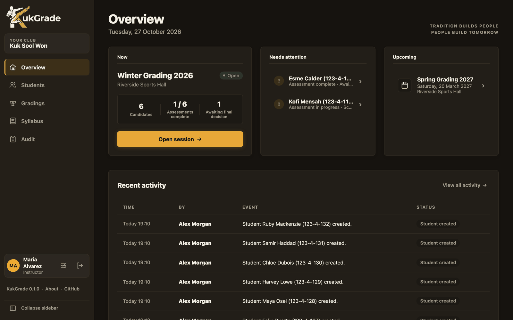
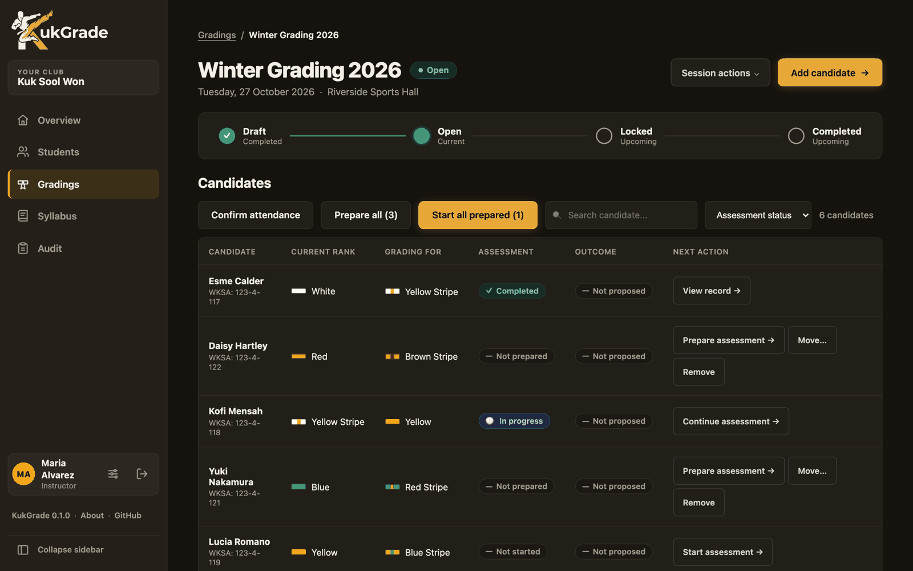
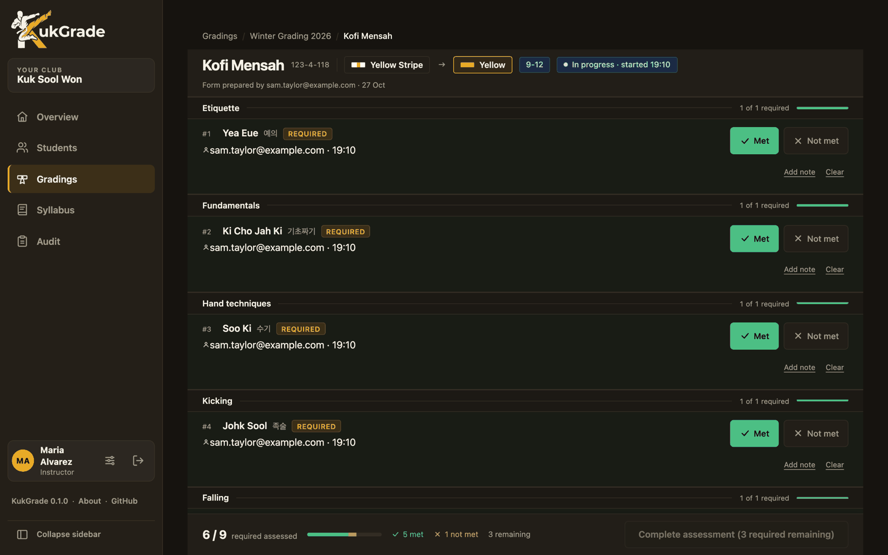
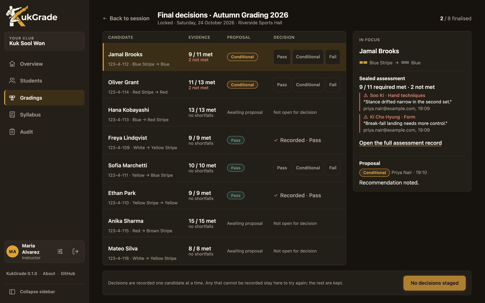
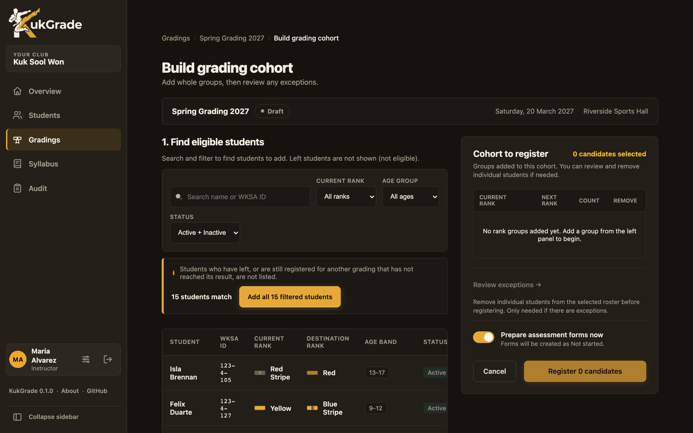
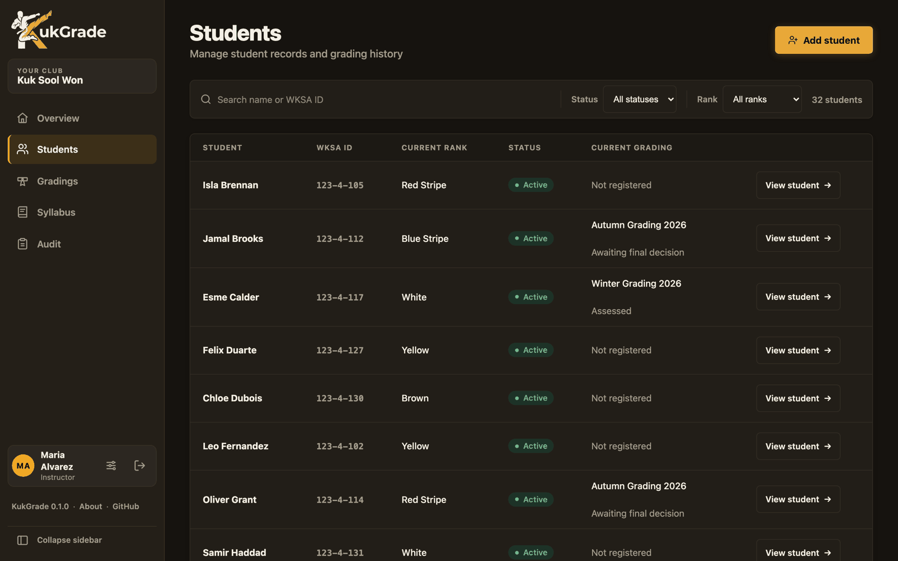
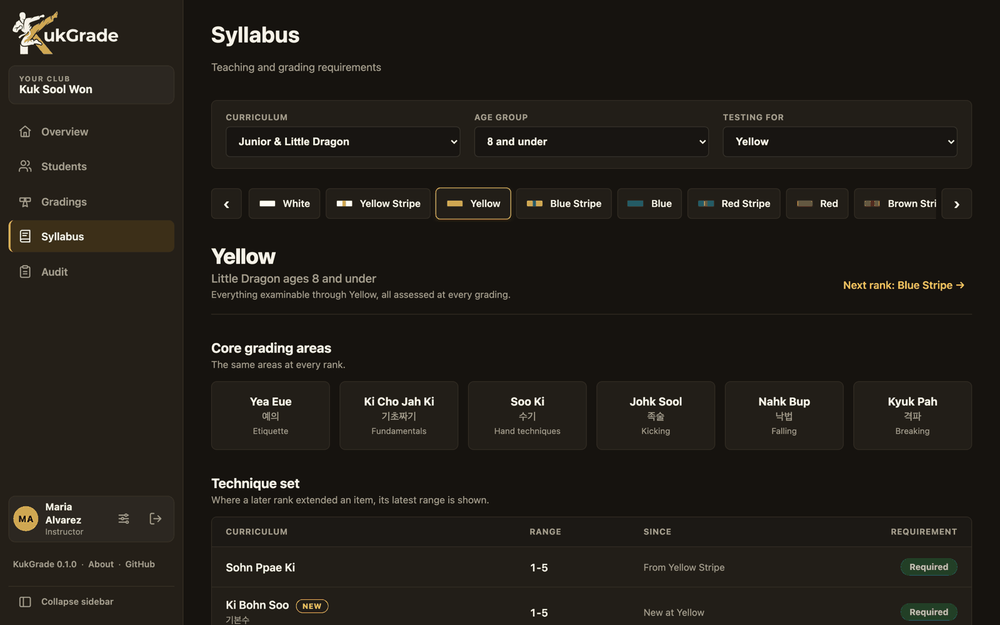
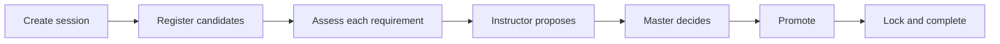

<div align="center">


### Grading management for Kuk Sool Won schools

Plan a grading, assess every candidate against the syllabus, record the Master's
decision, and promote students, with a permanent audit trail behind every step.

[](https://github.com/TheRedTower/KukGrade/actions/workflows/ci.yml)
[](LICENSE)
[](docs/installation.md)
[](docs/roadmap.md)

[**Quick start**](#quick-start) ·
[Features](#features) ·
[Screenshots](#screenshots) ·
[Documentation](docs/README.md) ·
[Roadmap](docs/roadmap.md) ·
[Contributing](CONTRIBUTING.md)

<br>



</div>

## Why KukGrade

Most schools run their gradings from spreadsheets: a roster here, a syllabus chart
there, results in a workbook nobody dares to edit. KukGrade replaces that with one
place that knows the syllabus, remembers every result exactly as it was recorded,
and shows who decided what.

- **Built for the grading day.** Mark each requirement met or not met from a tablet or
  phone, with a live count of what is left.
- **The right syllabus, automatically.** Each candidate is assessed against everything
  examinable for their rank and age band. A later syllabus change can never alter a past grading.
- **The Master decides.** Instructors propose; only people with final-decision authority
  can make a result final, and promotion is a separate, deliberate step.
- **Nothing is lost or quietly changed.** Finalised results are immutable, and an
  append-only audit log records every sensitive action.
- **Yours to run.** One Docker container with its own database, on your own server.
  Student data never leaves your hands.

## Features

| | |
| --- | --- |
| **Grading sessions** | Draft → Open → Locked → Completed, with a cohort builder that registers a whole mixed-belt group in one step |
| **Assessment** | Item-level *Met / Not met* with notes, results rolled up by category, attendance confirmed in bulk |
| **Decisions** | Instructor proposals, a Master's decision board, Pass / Fail / Conditional, then promotion with permanent rank history |
| **Students** | Records, status (active, inactive, left), school and national IDs, and one timeline of every grading |
| **Syllabus** | WKSA charts for the ranks up to Jo Kyo Nim and every age band, held as data, never hard-coded |
| **Import** | Bring in an existing roster, and past gradings from an old spreadsheet, with a guided review |
| **Accounts & roles** | Instructors and administrators; Master authority granted per person; temporary passwords that expire |
| **Audit log** | Who did what, when, written in the same transaction as the change |
| **Secure by default** | HTTPS, no default accounts, a strong password policy, a minimal unprivileged image |

See [docs/features.md](docs/features.md) for the full picture, including who can do what.

## Quick start

You need [Docker](https://docs.docker.com/get-docker/) with Compose v2 and git.

```sh
git clone https://github.com/TheRedTower/KukGrade.git
cd KukGrade/deploy
cp .env.example .env
docker compose up -d
```

The first run pulls the image, which takes a minute or two. Then:

```sh
docker compose logs | grep "setup code"
```

Open <https://localhost:6942> (accept the self-signed certificate warning), enter the setup
code, and create your first administrator. That is the whole install: the container carries
its own PostgreSQL, and everything it stores is in `deploy/data/`.

For a real deployment, put it behind HTTPS with Caddy, nginx, Traefik, a Cloudflare Tunnel or
Pangolin: see the [installation guide](docs/installation.md). Every setting is in
[configuration](docs/configuration.md).

## Screenshots

<table>
  <tr>
    <td width="50%">
      
      <p align="center"><b>Run a grading session</b><br>Lifecycle, candidates and next actions at a glance</p>
    </td>
    <td width="50%">
      
      <p align="center"><b>Assess on the mat</b><br>Mark every requirement, with a live count</p>
    </td>
  </tr>
  <tr>
    <td width="50%">
      
      <p align="center"><b>Decide</b><br>The evidence, the proposal and the final decision, side by side</p>
    </td>
    <td width="50%">
      
      <p align="center"><b>Build a cohort</b><br>Add whole groups, then review exceptions</p>
    </td>
  </tr>
  <tr>
    <td width="50%">
      
      <p align="center"><b>Know your students</b><br>Search, filter, and see each one's current grading</p>
    </td>
    <td width="50%">
      
      <p align="center"><b>Browse the syllabus</b><br>By rank and age band, cumulative to each rank</p>
    </td>
  </tr>
</table>

*All data shown is made up.*

## How a grading flows



## Documentation

| | |
| --- | --- |
| [Installation](docs/installation.md) | Run it, put it on the internet, back it up, update it |
| [Configuration](docs/configuration.md) | Every setting |
| [Features](docs/features.md) | What it does, and who can do what |
| [Importing data](docs/importing-data.md) | Rosters and historical gradings |
| [API](docs/api.md) | The HTTP API and its OpenAPI schema |
| [Architecture](docs/architecture.md) | How it is built |
| [Development](docs/development.md) | Run from source, run the tests |
| [Roadmap](docs/roadmap.md) | What is coming, and what is not |

## Built with

Python 3.14 · Django · Django REST Framework · PostgreSQL 17 · React 19 · TypeScript · Vite ·
Docker. Fully typed and tested (pytest, Vitest, Ruff, mypy, ESLint), with every API type
generated from one OpenAPI schema.

## Status

KukGrade is **pre-1.0**. It is complete for the core grading workflow and is being prepared
for its first production use; see the [roadmap](docs/roadmap.md) for what remains. It holds
personal data about students, so take a backup and test a restore before relying on it.

## Contributing and security

Bug reports and pull requests are welcome: read [CONTRIBUTING.md](CONTRIBUTING.md) first, and
please never include real student data. To report a vulnerability, follow [SECURITY.md](SECURITY.md).
Everyone taking part is expected to follow the [Code of Conduct](CODE_OF_CONDUCT.md).

## Licence

[GNU Affero General Public License v3.0](LICENSE). You may use, modify and self-host KukGrade freely;
if you offer a modified version to others over a network, you must make your source available to them.

KukGrade is an independent project. It is not affiliated with, endorsed by or sponsored by the World
Kuk Sool Association; "Kuk Sool Won" and "WKSA" belong to their respective owners.
