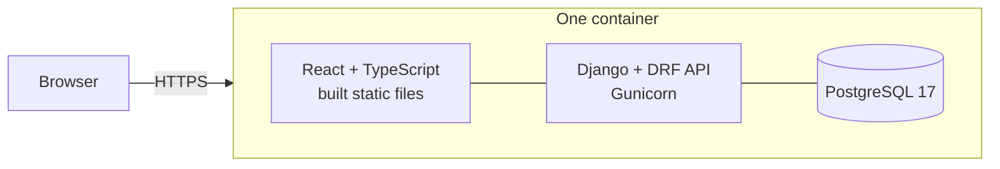

# Architecture

KukGrade is a **modular monolith**: one Django/DRF backend, one React frontend and
one PostgreSQL database, shipped as a single container. There are no microservices
and no background worker; one will be added only when something genuinely has to run
asynchronously.



| Layer | Technology |
| --- | --- |
| Backend | Python 3.14, Django 5.2 (LTS), Django REST Framework, drf-spectacular |
| Frontend | React 19, TypeScript, Vite, React Router, TanStack Query, plain CSS on design tokens |
| Database | PostgreSQL 17 |
| Testing | pytest, Vitest and React Testing Library |
| Quality | Ruff, mypy, ESLint, GitHub Actions |
| Packaging | One multi-stage `Dockerfile`; WhiteNoise serves the built frontend |

## Repository layout

```
backend/    Django project and apps (API, domain rules, tests)
frontend/   React app (screens, components, generated API types)
deploy/     Docker Compose files for running the image anywhere
docs/       This documentation
Dockerfile  The production image
```

## Backend apps

| App | Owns |
| --- | --- |
| `kukgrade` | Settings, routing, the error envelope, pagination, query filters, serving the frontend |
| `accounts` | Email-first staff users, role groups, per-user authority permissions, password policy, first-administrator setup |
| `audit` | The append-only `AuditEvent` log and the single `record()` function that writes it |
| `ranks` | The seeded rank catalogue |
| `students` | Students, status, WKSA IDs, rank and grading history |
| `syllabus` | Syllabus items, per-rank and age-band requirements, and the cumulative resolver |
| `gradings` | Sessions, candidates, assessment snapshots, outcomes, promotions, imported legacy records |
| `data_imports` | Import batches and stored rows; roster import and the historical workbook adapter |
| `about` | What is running and on what terms: the project's own facts (`project.py`), its documents read from the repository's files, the Kuk Sool Won pledge, and the credits written when an image is built |
| `health` | Liveness and database checks used by the container health check |

## Principles

**The backend is the authority.** Permission checks, grading rules and syllabus
rules live in the backend and are exposed through the API. The frontend reflects
what the server says is allowed (for example, a candidate carries `can_be_moved`),
and never hard-codes a rule.

**Services own every state change.** Each app has a `services.py` that validates a
change, writes it in a transaction, and records its audit event in that same
transaction. Views, serializers and the Django admin all call the same services, so a
change is validated and audited identically however it arrives.

**Models refuse the worst mistakes themselves.** Session status transitions, deletion
rules, and the immutability of finalised outcomes, promotions, audit events and
imported source text are enforced in the models and their querysets, so they hold from
a shell or a bulk query, not only through the API.

**Permissions fail closed.** Every API viewset declares a `permission_map` per action;
an action that is not declared is denied. Django permissions are the authority; the
`role` field is only a label that decides group membership.

**History is reproducible.** Generating an assessment copies every requirement's text
into immutable per-candidate rows, so editing the syllabus later cannot change a past
grading. Promotions, finalised outcomes and audit events are immutable; imported
records are voided, never deleted.

**One lock protocol.** Concurrent grading writes lock the grading session first, then
any students in ascending id order, and validate only against rows re-read under those
locks (`gradings/locking.py`). Bulk endpoints process each row independently in its own
savepoint and report per-row errors, so one bad row does not block the rest.

**The schema is the contract.** Every request and response is declared in the backend
and published as `backend/schema.yml` (OpenAPI). The frontend's TypeScript types are
generated from it, and CI fails if either drifts. See [api.md](api.md).

## Frontend

React with React Router and TanStack Query; styling is one stylesheet per feature on
the design tokens in `frontend/src/theme.css` (a warm gold-on-charcoal palette with
light and dark themes). API types are generated into `frontend/src/api/schema.ts`, and
`frontend/src/api.ts` holds the fetch functions.

Two behaviours worth knowing:

- **Sign-in state has four values**, not three: `loading`, `authenticated`, `anonymous`
  and `error`. `anonymous` needs a real answer from the server (a 401). A dropped
  connection or a 5xx is `error`, with a retry, so a backend hiccup never signs
  someone out mid-grading. Signing out clears local state only after the server
  confirms.
- **API errors** arrive in one envelope and are surfaced as an `ApiError` carrying
  `status`, `code` and per-field `fields`, so domain-rule failures can be shown as a
  message without inspecting individual fields.

## The production image

A multi-stage build compiles the frontend, installs locked Python dependencies and
copies a finished, minimal filesystem into a fresh image. It contains the app,
PostgreSQL 17 and nothing else needed to run or repair it: no tests, documentation,
build tools or package-manager caches. It runs as an unprivileged user (UID 10001), and
base images are pinned by digest and kept current by Dependabot.

On start, `kukgrade.serve` starts the image's own PostgreSQL (unless `POSTGRES_HOST`
points elsewhere), applies migrations, then starts one Gunicorn worker. The Django admin
site is not mounted on the network app. See [installation.md](installation.md).

## Decisions worth knowing

- **Why one worker?** Sign-in throttling uses process-local memory. Scaling out needs a
  shared cache first.
- **Why no SQLite?** A SQLite fallback once existed and could not actually run this
  application, so it was removed rather than half-supported.
- **Why no syllabus versioning?** Copying requirement text into each assessment already
  makes history reproducible. An explicit published-version entity is deferred.
- **Why is "Master" not a role?** The authority to decide, promote and override is
  granted per person, so a school can assign it to one instructor without a third tier
  of role.
