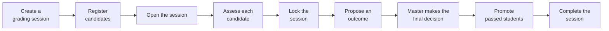

# Features

KukGrade takes a school from "who is grading?" to "who passed, and what rank are
they now?", and keeps an honest record of every step. It is used by staff
(instructors, administrators and the authorised Master); students never sign in.

## The grading workflow

1. **Create a session** with a title, date, location and notes. A session moves through **Draft → Open → Locked → Completed**, or is
   **Cancelled**.
2. **Register candidates.** The cohort builder lists the students who are
   eligible; a student can be in only one unfinished grading at a time, and a
   student who has left cannot be registered. Each candidate tests for their own
   next rank, so a mixed-belt group registers in one step. Candidates can be
   moved or removed while the session is a draft or open.
3. **Assess.** Each candidate's assessment is generated (singly or for a whole
   cohort) as a copy of the **cumulative syllabus** for their age band, from White
   up to the rank they are testing for, and started deliberately. Assessors mark
   each item **Met** or **Not met**. Anyone marking or reviewing can add comments
   to an item, including one that is already marked and from several people (each
   adds their own observations); they keep their author and time and are never
   edited or removed, and adding one never changes the mark;
   category results are worked out from the items. Attendance is confirmed in bulk: tick the no-shows
   and confirm.
4. **Lock.** A session can only be locked when every assessment is complete.
   Locking ends the grading and opens the decisions.
   - *Until the lock*, a mark can be changed, including on a completed assessment, but
     every change after the first mark needs a written reason (even changing your own, even
     clearing it). The change, who made it, when and why are kept and shown on the item, and
     a completed assessment keeps every required item marked. The log starts with the release
     that added it (0.2.0-rc.8): an item marked before then begins with its mark at that time,
     credited to its assessor, and changes made before it, including a mark cleared then, are
     not known.
   - *After the lock*, only the authorised Master can correct a mark or add a comment,
     always with a written reason, until that candidate's final decision is recorded. Each
     such change is flagged "after the lock" and shown with the decision (on the final
     decisions screen and the assessment record). Once the decision is recorded, the
     candidate's record is fixed.
   - *Withdrawing:* after the lock, a candidate can be withdrawn with a recorded reason by
     someone with the authority.
5. **Propose an outcome.** In the locked session, instructors propose **Pass**, **Fail** or
   **Conditional**. A conditional result must say what the candidate still has to do.
6. **Final decision.** Only a person with *final grading decision* authority
   (the Master) can finalise an outcome. A finalised outcome can never be edited.
   Decisions the Master has chosen but not yet recorded ("staged") are saved on the
   server for that Master alone, so a session that times out or a closed tab loses
   nothing; recording a decision, or the session leaving the locked state, removes
   them. Staging is not audited, because it decides nothing; recording is.
7. **Promote.** A Pass is promoted in a separate, deliberate step, which updates the
   student's rank and writes a permanent rank-history record. A whole cohort can be
   promoted at once. Promoting is possible while the session is locked and after it is
   completed.
8. **Complete.** A session can be completed when every candidate who was not withdrawn
   has a final decision.
   - *Cancelling and deleting:* a session that has recorded a final decision can no longer be
     cancelled or deleted.
   - *Archiving:* a completed or cancelled session can be archived by an administrator. It is
     hidden from the list of gradings (shown under "Archived gradings"), nothing is erased,
     and it can be restored.

Every step is recorded in the [audit log](#audit-log).

## Students

- Records with name, date of birth, current rank and grade, status and ID.
- Status is **Active**, **Inactive** (a temporary break; blocks nothing) or
  **Left** (blocks registering for a grading). Both are reversible and history is
  always kept. Missing a grading never marks a student as having left.
- IDs follow the school's pattern (such as `123-4-150`, set with `KUKGRADE_SCHOOL_PREFIX`)
  or the national black belt ID format (`A-12345`). Old IDs are remembered and never reused.
- A student's page shows their rank history and a single timeline of every grading,
  native and imported. A grading run in KukGrade shows the rank the student held,
  their age band and, for a Conditional result, what is still required, and links
  to its assessment.
- Correcting a date of birth moves the student's open registrations to the right age band, unless an assessment form is already prepared in a different band: then it is refused until the form is removed.
- A student's rank cannot be edited while they are registered for a grading that has not reached its result: withdraw them first.
- Search by name, ID (current or previous, with or without its hyphens), rank or status; filter by rank and status. See [Search](#search).

## The syllabus

The syllabus is read-only reference data in the database (the World Kuk Sool
Association 2014 charts), never
hard-coded in the interface. The screen lists only the ranks that have a syllabus recorded: Yellow
Stripe to Jo Kyo Nim today. White has none of its own, and the ranks above Jo Kyo Nim are
not recorded yet; those ranks stay in the data but are out of the syllabus screen and the
grading flow (nobody can be registered to be graded for them) until their charts are added. The
same holds per age band: a student whose band has no chart for the rank they would test for
cannot be registered, and is not offered, until that band's chart is added. Which requirements
apply depends on **rank** and **age band** (8 and under, 9–12, 13–17, 18+). Each
grading covers the *cumulative* syllabus: everything examinable up to the rank
being tested, not only that rank's new material.

When an assessment is created, the full text of every requirement is copied into
the candidate's own record. A later change to the syllabus therefore **cannot alter
a past grading**; historical results always read exactly as they were assessed.

Ranks run White, Yellow Stripe, Yellow, Blue Stripe, Blue, Red Stripe, Red, Brown
Stripe, Brown, Black Stripe, then the dahn and master titles DBN, JKN, KSN, PSBN,
SBN and PKJN (Dahn Bo Nim to Pyung Kwahn Jung Nim). Every screen draws ranks as the actual belt.

## Importing existing records

Administrators can bring in an existing student list and, if the school has one,
a spreadsheet of past gradings, with a guided review before anything is saved.
An upload that is abandoned is cleared once it is 24 hours old: each new upload clears
the stale ones, and so does every start of the container. A past-gradings workbook saved again
and uploaded twice is warned about, and its repeated records marked, before anything is
imported. See [importing-data.md](importing-data.md).

## Search

Every search box (gradings, students, users, a grading's candidates, the audit log, imports and
historical records) uses the same search, done by the database:

- **Every word must be found**, in any order ("kim alex" finds Alex Kim).
- **Accents and capitals do not matter** ("jose" finds José).
- **Part of a word counts**, as you type ("spr" finds Spring).
- **A slip of the keyboard is forgiven** for words made of letters ("sprng", "hartly"). A word with a
  digit in it, such as an ID or a year, is matched exactly: 123-4-150 is never "like" 123-4-151.
- **What the screen shows can be typed**: a grading is found by its date or status ("october",
  "2026", "25/10/2026", "locked"), a student by rank or status, a candidate by their ranks.
- **The best match comes first**, unless you have chosen an order.

## Audit log

An append-only record of who did what and when: sessions, assessments, final
decisions, promotions, student and rank changes, user and permission changes,
deletions and imports. Each event is written in the same database transaction as
the change, so there is never an event for something that did not happen, nor a
change without an event. Events cannot be edited or deleted through the app, the API or
the admin. It stays attributed to a person even if their account is
later deleted. New events never hold a student's name or date of birth: they
name the student by WKSA ID and say which fields changed, and the screens add
the student's current name while they exist. Older events can be cleaned on
request ([Privacy](privacy.md)).

**A record's history.** A grading, a student, a registration's assessment record and a user account
each have a **History** link (for those who may read the audit log) that opens the log narrowed to
that record and everything that belongs to it, named at the top with a link back: a grading's
history includes its registrations, assessments, marks, decisions and promotions; a student's is
their own record and every grading event about them; an assessment record's is that one
registration; a user's is what was done to the account and what they did. Marks and comments say
whose they are (by WKSA ID), so a grading's history reads as a story. Events written before this
carry fewer ids, so a record is followed through what still exists (a deleted candidate's older
events may not be gathered into its grading's history).

## Users and settings

- Administrators create staff accounts, set roles and status, grant authority, and
  reset passwords.
- Nobody types a password for someone else. A new account or a reset produces a
  **temporary password**, shown once, valid for 24 hours, that must be changed at
  first sign-in.
- Passwords are 16–64 characters with upper case, lower case, a number and a special
  character, and are checked against common-password lists.
- Every page carries a Content-Security-Policy: the browser runs only the app's own scripts
  and styles, loads nothing from elsewhere and will not let the app be framed, so a script
  injected into a page could neither run nor send anything out. `KUKGRADE_CSP` can turn it
  down to report-only, or off, if a proxy or extension interferes
  ([configuration](configuration.md)).
- Light, dark or system theme, keyboard-accessible dialogs, and layouts that adapt to phone and tablet widths (awaiting a check on real devices: `docs/roadmap.md`).
- **About** (Settings): the version, build and what to quote when asking for help; the licence
  (AGPL-3.0-only, with a short plain-words guide and the full text); the Kuk Sool Won pledge and
  the code of conduct; the security policy; support contacts; and credits for the open source
  projects KukGrade is built on. Everything comes from the server: the documents are the
  repository's own files, the contact addresses and licence are written once in
  `backend/about/project.py`, and the credits are written when each image is built. An
  administrator also sees the school's settings, read-only.

## Roles and permissions

There are two roles, **Instructor** and **Administrator**. "Authorised Master" is
not a role: it is three separate permissions that can be given to one trusted
person, and a fourth that lets someone read the audit log. The server checks every
permission on every request; hiding a button in the interface is never the only
protection.

| Capability | Instructor | Administrator | Master permissions |
| --- | :---: | :---: | :---: |
| View ranks, syllabus, students, history | ✓ | ✓ | |
| Add and edit students; manage sessions, candidates and assessments | ✓ | ✓ | |
| Propose or revise an outcome | ✓ | ✓ | |
| **Make the final grading decision** (`can_make_final_grading_decision`) | | | ✓ |
| **Promote a student** (`can_promote_student`) | | | ✓ |
| **Withdraw a candidate from a locked session** (`can_override_locked_session`) | | | ✓ |
| Read the audit log | with `can_view_grading_audit_log` | ✓ | ✓ |
| Manage users, roles and authority | | ✓ | |
| Import student rosters and past gradings; reconcile imported history | | ✓ | |
| Delete a user or student, or an assessment or session without final decisions | | ✓ | |
| Archive or restore a completed or cancelled session | | ✓ | |

Notes:

- An administrator cannot also hold final-decision authority: the person who
  manages accounts is not the person who decides gradings.
- Nobody can change their own role, status or authority.
- Only a superuser (the first administrator) can change an account that can use the
  Django admin site.
- The Django admin site (a shell-only emergency tool, not served by the app) shows
  grading, student, rank and syllabus data but cannot add, change or delete it, so
  every such change is checked and recorded by KukGrade. It still recovers accounts,
  but deletes none: an account is deleted in KukGrade.
- User-management events in the audit log are visible to administrators only.
- Deleting never erases a recorded decision, and is itself audited.
  - *A student* is never deleted before their final decision: while any grading they are
    in has not reached it (a Pass waits for its promotion), deleting them is refused with a
    message that names that grading. Once it has, or once they are taken out, they can be
    deleted: they leave the student list and searches, cannot be registered, and their
    record is closed to changes, but it is kept, so every past grading, mark, decision and
    promotion still shows who it was. Only a record with no grading history at all (added
    by mistake, twice, or for testing) is erased, and its WKSA IDs are never given out again.
  - *A staff account* that recorded anything is closed rather than erased: it can no longer
    sign in, leaves the staff list, and its email cannot be reused, while every comment,
    mark, proposal and decision keeps its name. One that recorded nothing is erased.
  - *A session or an assessment* holding a final decision cannot be deleted.

## The demo mode

Started with `KUKGRADE_DEMO_MODE=1`, the same image runs as a public demo with made-up data,
for people to try the whole workflow without consequences. It is for a demo site only, never
a real club. See [demo.md](demo.md) for how to run it.

- **Shared sign-ins.** The sign-in page offers three accounts (Instructor, Master,
  Administrator) with one click each. None is a superuser, so the permission boundaries are
  the real ones, and any number of people can use the same account at once.
- **A made-up club**, with a grading in every state: completed (with promotions and a Master
  override of a recommendation), locked and waiting for the final decision, open with
  assessments part way, and planned with students not yet registered.
- **It resets itself** every few hours (`KUKGRADE_DEMO_RESET_HOURS`, default 6), so whatever
  visitors type does not last. The accounts stay, so nobody is signed out. A banner shows when.
- **What is closed:** changing a password, changing accounts, and uploading files. First-time
  setup is never offered.
- **It never touches real data.** It refuses to build or reset a database that holds any
  account other than its own three.

## What KukGrade does not do (yet)

Reports and exports, certificates, notifications and offline use, and it has no syllabus
for the ranks above Jo Kyo Nim. See the [roadmap](roadmap.md).
