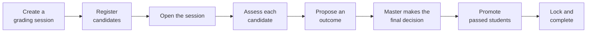

# Features

KukGrade takes a school from "who is grading?" to "who passed, and what rank are
they now?", and keeps an honest record of every step. It is used by staff
(instructors, administrators and the authorised Master); students never sign in.

## The grading workflow

1. **Create a session** with a title, date, location and notes. A session moves through **Draft → Open → Locked → Completed**, or is
   **Cancelled**.
2. **Register candidates.** The cohort builder lists the students who are
   eligible; a student can be in only one unfinished grading at a time, and a
   student who has left cannot be registered. Each candidate tests for their own
   next rank, so a mixed-belt group registers in one step. Candidates can be
   moved or removed while the session is a draft or open.
3. **Assess.** Each candidate's assessment is generated (singly or for a whole
   cohort) as a copy of the **cumulative syllabus** for their age band, from White
   up to the rank they are testing for, and started deliberately. Assessors mark
   each item **Met** or **Not met**, with an optional note; category results are
   worked out from the items. Attendance is confirmed in bulk: tick the no-shows
   and confirm.
4. **Propose an outcome.** Instructors propose **Pass**, **Fail** or
   **Conditional**. A conditional result must say what the candidate still has to do.
5. **Final decision.** Only a person with *final grading decision* authority
   (the Master) can finalise an outcome. A finalised outcome can never be edited.
6. **Promote.** A Pass is promoted in a separate, deliberate step, which updates the
   student's rank and writes a permanent rank-history record. A whole cohort can be
   promoted at once.
7. **Lock and complete.** A session can only be locked when every assessment is
   complete. Mistakes can be corrected (a completed assessment can be reopened) until
   the session locks; after that, a candidate can be withdrawn with a recorded
   reason by someone with the authority.

Every step is recorded in the [audit log](#audit-log).

## Students

- Records with name, date of birth, current rank and grade, status and ID.
- Status is **Active**, **Inactive** (a temporary break; blocks nothing) or
  **Left** (blocks registering for a grading). Both are reversible and history is
  always kept. Missing a grading never marks a student as having left.
- IDs follow the school's pattern (such as `123-4-150`, set with `KUKGRADE_SCHOOL_PREFIX`)
  or the national black belt ID format (`A-12345`). Old IDs are remembered and never reused.
- A student's page shows their rank history and a single timeline of every grading,
  native and imported.
- Search by name or ID; filter by rank and status.

## The syllabus

The syllabus is read-only reference data in the database (the World Kuk Sool
Association 2014 charts), never
hard-coded in the interface. The screen lists only the ranks that have a syllabus recorded: Yellow
Stripe to Jo Kyo Nim today. White has none of its own, and the ranks above Jo Kyo Nim are
not recorded yet; those ranks stay in the data but are out of the syllabus screen and the
grading flow (nobody can be registered to be graded for them) until their charts are added. Which requirements
apply depends on **rank** and **age band** (8 and under, 9–12, 13–17, 18+). Each
grading covers the *cumulative* syllabus: everything examinable up to the rank
being tested, not only that rank's new material.

When an assessment is created, the full text of every requirement is copied into
the candidate's own record. A later change to the syllabus therefore **cannot alter
a past grading**; historical results always read exactly as they were assessed.

Ranks run White, Yellow stripe, Yellow, Blue stripe, Blue, Red stripe, Red, Brown
stripe, Brown, Black stripe, then the dahn and master titles from Dahn Bo Nim to
Pyung Kwahn Jung Nim. Every screen draws ranks as the actual belt.

## Importing existing records

Administrators can bring in an existing student list and, if the school has one,
a spreadsheet of past gradings, with a guided review before anything is saved.
See [importing-data.md](importing-data.md).

## Audit log

An append-only record of who did what and when: sessions, assessments, final
decisions, promotions, student and rank changes, user and permission changes,
deletions and imports. Each event is written in the same database transaction as
the change, so there is never an event for something that did not happen, nor a
change without an event. Events cannot be edited or deleted through the app, the API or
the admin. It stays attributed to a person even if their account is
later deleted.

## Users and settings

- Administrators create staff accounts, set roles and status, grant authority, and
  reset passwords.
- Nobody types a password for someone else. A new account or a reset produces a
  **temporary password**, shown once, valid for 24 hours, that must be changed at
  first sign-in.
- Passwords are 16–64 characters with upper case, lower case, a number and a special
  character, and are checked against common-password lists.
- Light, dark or system theme, keyboard-accessible dialogs, and layouts that work at phone width.

## Roles and permissions

There are two roles, **Instructor** and **Administrator**. "Authorised Master" is
not a role: it is three separate permissions that can be given to one trusted
person, and a fourth that lets someone read the audit log. The server checks every
permission on every request; hiding a button in the interface is never the only
protection.

| Capability | Instructor | Administrator | Master permissions |
| --- | :---: | :---: | :---: |
| View ranks, syllabus, students, history | ✓ | ✓ | |
| Add and edit students; manage sessions, candidates and assessments | ✓ | ✓ | |
| Propose or revise an outcome | ✓ | ✓ | |
| **Make the final grading decision** (`can_make_final_grading_decision`) | | | ✓ |
| **Promote a student** (`can_promote_student`) | | | ✓ |
| **Withdraw a candidate from a locked session** (`can_override_locked_session`) | | | ✓ |
| Read the audit log | with `can_view_grading_audit_log` | ✓ | ✓ |
| Manage users, roles and authority | | ✓ | |
| Import student rosters and past gradings; reconcile imported history | | ✓ | |
| Permanently delete a user, student, assessment or session | | ✓ | |

Notes:

- An administrator cannot also hold final-decision authority: the person who
  manages accounts is not the person who decides gradings.
- Nobody can change their own role, status or authority.
- Only a superuser (the first administrator) can change an account that can use the
  Django admin site.
- User-management events in the audit log are visible to administrators only.
- Deleting is for correcting mistakes and clearing test data. Deleting a student or
  session removes its dependent records and is itself audited; removing a user keeps
  the history attributed to them by name.

## The demo mode

Started with `KUKGRADE_DEMO_MODE=1`, the same image runs as a public demo with made-up data,
for people to try the whole workflow without consequences. It is for a demo site only, never
a real club. See [demo.md](demo.md) for how to run it.

- **Shared sign-ins.** The sign-in page offers three accounts (Instructor, Master,
  Administrator) with one click each. None is a superuser, so the permission boundaries are
  the real ones, and any number of people can use the same account at once.
- **A made-up club**, with a grading in every state: completed (with promotions and a Master
  override of a recommendation), locked and waiting for the final decision, open with
  assessments part way, and planned with students not yet registered.
- **It resets itself** every few hours (`KUKGRADE_DEMO_RESET_HOURS`, default 6), so whatever
  visitors type does not last. The accounts stay, so nobody is signed out. A banner shows when.
- **What is closed:** changing a password, changing accounts, and uploading files. First-time
  setup is never offered.
- **It never touches real data.** It refuses to build or reset a database that holds any
  account other than its own three.

## What KukGrade does not do (yet)

Reports and exports, certificates, notifications and offline use, and it has no syllabus
for Pyung Kwahn Jung Nim. See the [roadmap](roadmap.md).
