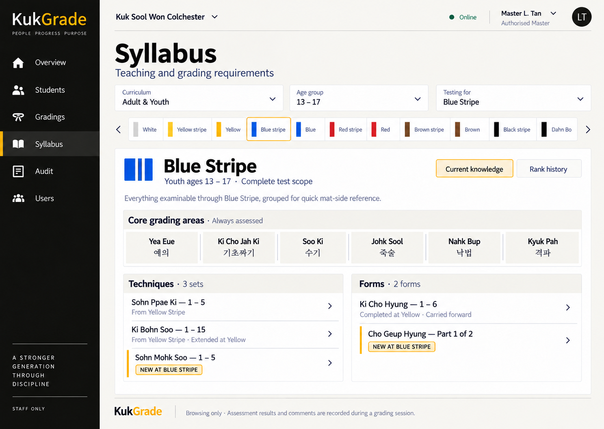

# KukGrade Frontend Design Register

Status: accepted design register with implementation tracking

Selected direction: Operational Ledger

Design pass: shared shell, management, assessment and promotion screens

Implementation truth remains `docs/current-system.md`; a screen being selected
here does not by itself mean it has shipped.

## Design decisions

| ID | Decision | Status | Notes |
| --- | --- | --- | --- |
| FDR-001 | Use Quiet Command as the visual base. | Approved | Modern, calm and operational, with a restrained traditional character. |
| FDR-002 | Use ink black, WKSA gold, warm white and charcoal as the principal palette. | Approved | Target balance is approximately 75% light surface, 20% ink structure and 5% gold accent. |
| FDR-003 | Reserve conventional green, amber and red for operational meaning. | Approved | Colour never carries meaning without text or an icon. |
| FDR-004 | Use a persistent ink navigation rail in both themes. | Approved | Maintains brand and positional continuity between light and dark modes. |
| FDR-005 | Use Overview, Students, Gradings and Syllabus for standard instructors; add Audit for the designated Master and administrators, and Users only for administrators. | Approved | Matches the current permission boundary. Reports, Certificates and Settings are excluded from first-release navigation. |
| FDR-006 | Make Overview an operational ledger rather than an analytics dashboard. | Approved | The selected concept prioritises Now, Needs attention, Upcoming and Recent activity. |
| FDR-007 | Use comfortable tablet-first density with minimum 44px interactive targets. | Approved | Data tables remain compact but touch-safe. |
| FDR-008 | Prefer grouped tables and divider-led lists to repeated cards. | Approved | Cards are reserved for genuinely independent content. |
| FDR-009 | Treat Active, Inactive and Left as distinct semantics. | Approved | Active uses success; Inactive is neutral or amber; Left uses a stronger blocking treatment. |
| FDR-010 | Keep the student list privacy-minimised. | Approved | Date of birth appears only on an intentionally opened student record. |
| FDR-011 | Use explicit text-plus-colour status treatments. | Approved | Applies to connectivity, sessions, assessments, outcomes and student status. |
| FDR-012 | Build dark mode from layered charcoal surfaces. | Approved | No simple inversion, pure-black content panels, neon glow or large gold fills. |
| FDR-013 | Use motion for feedback and orientation only. | Approved | Normal motion 120-260ms; reduced-motion support is mandatory. |
| FDR-014 | Keep KukGrade technically installable as a PWA without in-app installation UI. | Approved | Browser or operating-system installation remains available; KukGrade never prompts for it. Full offline assessment sync remains later work. |
| FDR-015 | Design assessment marking as its own workflow pass. | Approved | Includes item results, observations, completion, proposals, final decisions, promotion and offline/save states. |
| FDR-016 | Use Operational Ledger as the selected overview hierarchy. | Approved | Selected from three same-brand structural concepts on 2026-09-15. |
| FDR-017 | Use Rank Chapter as the selected syllabus hierarchy. | Approved | Curriculum, age group and destination rank remain visible above a horizontal rank progression. |
| FDR-018 | Separate universal grading areas from rank-specific Techniques and Forms. | Approved | Mirrors the preliminary WKSA chart structure without reproducing its dense paper layout. |
| FDR-019 | Treat the 2014 adult/youth and junior/little-dragon PDFs as preliminary reference sources. | Approved | Content requires confirmation before it becomes authoritative product data. |
| FDR-020 | Keep syllabus browsing separate from assessment recording. | Approved | P/F controls, comments and judging actions belong in the dedicated assessment pass. |
| FDR-021 | Hide Users from instructors in the first release. | Approved | The current API does not grant instructors `accounts.view_user`; showing a read-only tab would create a dead or forbidden route. |
| FDR-022 | Keep self-service account context in the profile menu. | Approved | Every signed-in user can inspect their own role and Master capabilities without access to the user-management API. |
| FDR-023 | Restrict account, password and authority management UI to administrators. | Approved | Master authority remains three permissions, never a role. |
| FDR-024 | Do not expose PWA installation inside KukGrade. | Approved | No install menu item, banner, modal, toast or onboarding prompt. |
| FDR-025 | Defer the persistent notification centre until a later build. | Approved | The first release has no bell, inbox or unread badge. It uses contextual feedback for saves, validation, errors, connectivity, session state and update readiness. A future centre requires an agreed notification model, sources, permissions, read state, retention and delivery behaviour. |
| FDR-026 | Use a ledger-preview layout when creating a grading session. | Approved | The form stays focused on title, grading date, location and notes while a restrained preview confirms the resulting Draft session. Time and status controls are excluded because they are not part of the current creation contract. |
| FDR-027 | Make candidate registration and assessment preparation bulk-first. | Approved | Bulk registration, automatic next-rank resolution, optional bulk assessment generation and a separate bulk assessment start now exist on the backend. Per-candidate controls remain for exceptions and late additions. |
| FDR-028 | Represent bulk operations as independently processed rows. | Approved | The implemented API returns successful rows plus indexed errors. The UI must never imply all-or-nothing success: it shows the exact created/updated count, identifies failures inline and provides a retry-failed-only action. |
| FDR-029 | Treat assessment generation and assessment start as different actions. | Approved | `generate_assessments: true` creates immutable snapshots in `NOT_STARTED`; it does not start grading. Preparation controls say `Prepare assessment forms`; the separate, deliberate `bulk-start` action says `Start assessments` and is available only after the session is open. |
| FDR-030 | Use a filter-and-rank-group cohort builder for bulk registration. | Approved | Staff can add all filtered eligible students or complete current-rank groups, then remove only genuine exceptions. The review summarises automatically derived destination ranks and offers optional preparation of `NOT_STARTED` assessment forms. Individual ticking is not the primary workflow. |
| FDR-031 | Resolve partial bulk-registration results through a simple editable exception list. | Approved | Show every flagged candidate once with their identity, plain-language issue and only relevant actions: view an existing registration, remove from the retry/cohort, or correct a genuinely inaccurate blocking student status. Successful rows remain saved, backend row indices are never exposed, and retry submits only resolved candidates. Status changes are explicitly cautioned and audited. |
| FDR-032 | Use a dual-pane command ledger layout for candidate assessment scoring. | Approved | Selected from three layout directions on 2026-09-16. Fixed left category sub-rail (~280px) provides permanent peripheral vision of overall candidate progress, while right panel hosts touch-safe segmented Met/Not-Met controls and inline assessor notes. |
| FDR-033 | Segmented 3-state control (`NOT_ASSESSED`, `MET`, `NOT_MET`) with minimum 48px touch targets for mat-side scoring. | Approved | Direct alignment with backend `CandidateAssessmentItem.Result` enum. One-tap evaluation suited for active dojang environments. |
| FDR-034 | Auto-saving row-level item evaluations with immediate attribution. | Approved | Prevents data loss during live gradings; matches the backend check constraint requiring assessor and timestamp on scored items. |
| FDR-035 | Strict UI completion lock: "Complete Assessment" remains disabled until zero required items remain unassessed. | Approved | Mirrors backend `validate_assessment_can_complete` service validation, preventing misleading error toasts. |
| FDR-036 | Use a side-by-side dual-card ledger layout for assessment completion review. | Approved | Selected from three layout directions on 2026-09-16. Left column provides total evaluation metrics and category breakdown table; right column isolates flagged not-met requirements, general notes, and the immutable seal confirmation. |
| FDR-037 | Use a right slide-over drawer layout for instructor outcome proposals. | Approved | Selected from three layout directions on 2026-09-16. Preserves candidate roster context in the background while providing dedicated vertical room for selectable recommendation cards, proposal rationale notes, and Master-authority disclosure. |
| FDR-038 | Use an expansive dual-column slide-over ledger for Authorised Master final decisions. | Approved | Selected from layout directions (synthesising slide-over efficiency with full-ledger depth) on 2026-09-16. Opens wide (~65% width) over the candidate roster to preserve scroll position and cohort context, while internally presenting an assessment criteria ledger with instructor proposal on the left, and Master adjudication cards, conditional requirements input, authority credential seal, and formal decision sealing on the right. |
| FDR-039 | Use a roster batch and inline promotion ledger for student rank conferral. | Approved | Selected from three layout directions on 2026-09-16. Provides individual row-level promotion triggers ('Promote to [Rank]') alongside a cohort promotion summary bar ('Promote Qualified Cohort') and pinned batch preview tray. Gated strictly by `can_promote_student` permission. Effective date is locked to session grading date. Contracts to row-level promotion with a server-side bulk-promote endpoint targeted for efficient cohort processing. |
| FDR-040 | Use in-page operational action banners for grading session state transitions. | Approved | Selected from layout directions on 2026-09-16. Instead of heavy multi-step wizards or disconnected drawers, the session roster proactively surfaces an elegant in-page operational banner beneath the title and progression track when stage prerequisites are satisfied (e.g. 'All assessments completed · Ready to lock session'). Clicking the direct action triggers a minimal 2-sentence confirmation dialog, maintaining quiet operational flow and zero modal fatigue. |
| FDR-041 | Revise the syllabus Rank Chapter into a cumulative Current Knowledge ledger. | Approved | Selected on 2026-09-19 and recorded on 2026-09-21. Keep the existing curriculum, age-band and destination-rank controls and horizontal rank progression. Within the selected rank, show universal core grading areas first, then cumulative Techniques and Forms with effective ranges, provenance and a restrained `NEW AT [RANK]` treatment. The backend, not React, must derive accumulation and provenance. |

## Concept screen register

| ID | Screen | Theme | File | Status |
| --- | --- | --- | --- | --- |
| SCR-001 | Operational overview | Light | `01-overview-light.png` | Selected concept |
| SCR-002 | Operational overview | Dark | `02-overview-dark.png` | First dark-theme concept |
| SCR-003 | Students list | Light | `03-students-list.png` | First concept |
| SCR-004 | Student detail and history | Light | `04-student-detail.png` | First concept |
| SCR-005 | Grading sessions list | Light | `05-gradings-list.png` | First concept |
| SCR-006 | Open grading session and candidate roster | Light | `06-grading-session-roster.png` | First concept |
| SCR-007 | Add student | Light | `07-add-student.png` | First concept |
| SCR-008 | Staff login | Light | `08-login.png` | First concept; unsupported persistent-login control removed |
| SCR-009 | Syllabus rank chapter | Light | `09-syllabus-rank-chapter.png` | Superseded by SCR-025, implemented 2026-09-21 |
| SCR-010 | Audit event list | Light | `10-audit-log.png` | Implemented; visible only to administrators and the designated Master |
| SCR-011 | Administrator users list | Light | `11-admin-users-list.png` | Implemented; administrator only |
| SCR-012 | Administrator user details and authority | Light | `12-admin-user-detail.png` | Implemented; administrator only |
| SCR-013 | Installed PWA offline shell | Light | `13-pwa-offline-shell.png` | First-release degraded state; no offline writes |
| SCR-014 | Instructor self-profile menu | Light | `14-instructor-profile-menu.png` | Selected; contains no installation action |
| SCR-015 | PWA update-ready notification | Light | `15-pwa-update-ready.png` | First concept; update is deferrable and never forced |
| SCR-016 | Create grading session with ledger preview | Light | `16-create-grading-session.png` | Selected concept |
| SCR-017 | Build grading cohort | Light | `17-build-grading-cohort.png` | Selected combined concept |
| SCR-018 | Resolve flagged cohort candidates | Light | `18-resolve-flagged-candidates.png` | Selected exception-editor concept |
| SCR-019 | Candidate assessment workspace | Light | `19-candidate-assessment-workspace.png` | Selected dual-pane concept |
| SCR-020 | Assessment completion review | Light | `20-assessment-completion-review.png` | Selected dual-card concept |
| SCR-021 | Instructor outcome proposal drawer | Light | `21-instructor-outcome-proposal.png` | Selected slide-over concept |
| SCR-022 | Authorised Master final decision slide-over | Light | `22-master-final-decision.png` | Selected hybrid slide-over ledger concept |
| SCR-023 | Roster batch and inline promotion ledger | Light | `23-student-promotion-flow.png` | Selected batch and inline promotion concept |
| SCR-024 | Grading session state transition action banner | Light | `24-session-state-transition.png` | Selected in-page operational banner concept |
| SCR-025 | Revised syllabus current-knowledge ledger | Light | `25-syllabus-current-knowledge-revised.png` | Implemented 2026-09-21 |

## Revised syllabus layout plan (2026-09-21)

### Purpose and status

**Implemented 2026-09-21.** SCR-025 replaced SCR-009 as the syllabus screen's
implementation target - the same route, rebuilt against a new
`GET /api/syllabus/requirements/effective/` cumulative endpoint
(`syllabus.services.effective_syllabus_requirements`) rather than the
single-rank list. Verified against the worked Blue Stripe example below
using the real seeded data, light/dark, desktop/tablet/mobile. The image
remains a design reference, not a source of exact copy, spacing or data -
the implementation renders the authoritative API response.

One deviation from the written spec, per direct feedback during review: the
`NEW AT [RANK]` label reads just `NEW`. The selected rank is already visible
via the belt rail and the `Testing for` selector, so repeating it on every
badge was redundant, and the full rank name wrapped awkwardly in the
Techniques/Forms table on narrow viewports. The full "new at
Blue Stripe" phrasing still appears in the adjacent Provenance column.

The revised screen must answer the instructor's operational question: **what is
this candidate expected to know and demonstrate through the selected rank?** A
rank's own newly introduced requirements are only part of that answer. Earlier
requirements remain examinable, and a later range for the same syllabus item
supersedes its earlier partial range in the effective view.

### Locked information hierarchy

1. Keep the existing application shell and `Syllabus` page heading.
2. Keep curriculum, age group and `Testing for` visible together.
3. Keep the horizontal rank progression and authentic belt swatches.
4. Identify the selected rank and age context, followed by the sentence that
   the view contains everything examinable through that rank.
5. Place `Core grading areas · Always assessed` before rank-specific content.
   Preserve the six areas as a compact, full-width strip rather than six
   dashboard cards.
6. Place cumulative rank-specific content below in two grouped ledgers:
   `Techniques` and `Forms`.
7. Show the effective range or part for each item, its provenance, and a small
   gold-outline `NEW AT [RANK]` label only when it is introduced at the
   selected rank.
8. Keep syllabus browsing separate from assessment recording. Do not add
   pass/fail controls, completion checks, comments, assessor actions or student
   results to this screen.

For the illustrated Blue Stripe example, the expected effective content is:

- Core grading areas: Yea Eue, Ki Cho Jah Ki, Soo Ki, Johk Sool, Nahk Bup and
  Kyuk Pah.
- Techniques: Sohn Ppae Ki `1-5` from Yellow Stripe; Ki Bohn Soo `1-15` from
  Yellow Stripe and extended at Yellow; Sohn Mohk Soo `1-5`, new at Blue
  Stripe.
- Forms: Ki Cho Hyung `1-6`, completed at Yellow and carried forward; Cho Geup
  Hyung `Part 1 of 2`, new at Blue Stripe.

These mappings were checked against the seeded `AGE_13_TO_17` Adult/Youth
requirements on 2026-09-21. `Part 1 of 2` is presentation wording for the
seeded `Chart notation: (1/2).` note, so the implementation must define and
test that display normalisation rather than copy it from the image. The UI
must render the authoritative API response rather than hard-code these names,
ranges or rank relationships.

### Required backend contract

The current requirements endpoint filters to rows attached directly to one
rank. It does not provide a cumulative effective syllabus or provenance, so
SCR-025 cannot be implemented correctly as a frontend-only regrouping.

Add a backend-owned read contract for an age band and selected rank. It may be
a dedicated endpoint or an explicitly named mode on the existing requirements
endpoint, but it must return one effective record per syllabus item with at
least:

- selected rank and age-band context;
- item code, display name, Korean name and category;
- effective numbered range or notes/part wording;
- required/optional state and display sequence;
- the rank where the item was introduced;
- the most recent rank at or before the selection that changed its effective
  requirement;
- whether it is new at the selected rank; and
- enough ordered provenance to explain extensions such as `1-5` becoming
  `1-15` without returning duplicate effective rows.

Derive the result from rank order, age band and syllabus data in the backend.
For repeated item mappings, the latest applicable mapping supplies the
effective requirement while the earliest mapping supplies introduction
provenance. The policy that requirements carry forward must be encoded and
tested in the domain/API layer. If a future syllabus needs an exception or a
requirement that stops carrying forward, extend the domain model explicitly;
do not add rank-specific exceptions to React.

Core grading areas must also come from backend/domain data. The implementation
must remove the current React-owned syllabus catalogue used for their names,
Korean labels and ordering.

### Frontend implementation notes

- Preserve FDR-001 through FDR-004, FDR-007, FDR-008, FDR-012 and FDR-013.
- Reuse the existing filters, belt rail, rank context and theme tokens. Do not
  introduce a second syllabus route or a new colour system.
- Group returned `TECHNIQUE_SET` and `FORM` requirements into the two ledgers.
  Render universal grading categories in the compact strip above them.
- Use gold only for the selected rank, focus/interaction and genuinely new
  material. Carried-forward and extended provenance remains muted neutral text.
- Keep rows divider-led and touch-safe. Avoid nested cards, dashboard metrics,
  search, pagination and decorative status indicators.
- Supply equivalent layered-charcoal dark styling even though SCR-025 records
  the selected light reference. Dark mode must follow FDR-012 rather than
  simply invert the image.
- Preserve loading, empty, permission and request-failure states. A valid
  empty result must not be presented as a successful cumulative curriculum.
- Regenerate the OpenAPI schema and frontend types if the API contract changes;
  do not introduce hand-written response types.

### Verification and acceptance criteria

- Backend tests prove cumulative selection, range supersession, provenance,
  selected-rank `is_new` behaviour, age-band isolation, ordering, invalid
  parameters and permission enforcement.
- A Blue Stripe regression test proves that an earlier partial range and its
  later extension produce one effective row with the later range.
- Frontend tests prove that core grading areas render above Techniques and
  Forms; new and carried-forward items receive the correct text treatment; and
  changing curriculum, age band or rank requests and renders the new context.
- Loading, empty, API-error and narrow/tablet layouts are covered.
- Light, dark, keyboard, focus, contrast and reduced-motion behaviour are
  checked against the shared design rules.
- Existing assessment snapshot generation remains backend-owned and
  historically reproducible. This browsing change must not rewrite or infer
  past assessment snapshots.
- No dependencies, migrations or syllabus-data edits are required merely to
  reproduce the selected layout. Any proposed schema change must first be
  justified by a real carry-forward exception or another accepted domain need.

## Preliminary curriculum-source interpretation

- Adult & Youth is the source track for ages 13-17 and 18+.
- Junior & Little Dragon is the source track for ages 9-12 and 8 and under.
- Yea Eue, Ki Cho Jah Ki, Soo Ki, Johk Sool, Nahk Bup and Kyuk Pah are universal grading areas shown separately from rank-specific curriculum.
- Rank-specific content is organised into parallel Techniques and Forms requirements.
- Junior requirements differ by age group, so age context must remain visible at all times.
- The source-chart P/F and Comments columns inform the later assessment-form design; they are not part of syllabus browsing.
- The PDFs' printed `Do Not Alter` wording is source-document content, not an instruction governing this preliminary digital design pass.

## Corrections required during Figma reconstruction

- Render `INACTIVE` with a neutral or amber treatment, not the same danger treatment as `LEFT`.
- Replace all illustrative rank-history rows with a sequence validated against the seeded rank catalogue.
- Validate every mock date, status and transition against generated API types before treating copy as final.
- Replace concept-only icons with one consistent accessible icon library.
- Create two application-rail variants: Instructor without Users, and Administrator with Users.
- Label the signed-in user's role and Master capabilities separately in the profile menu; never present Master as a role.
- Verify contrast, focus states, zoom behaviour and reduced motion in both themes.
- Do not treat image-generated spacing or text as exact implementation measurements.

## Implementation coverage (2026-09-21)

- Implemented: login and application shell, Overview, Students list/detail/add,
  Gradings list/create/detail, cohort builder and exception handling, the
  SCR-025 cumulative syllabus ledger, assessment workspace/completion,
  outcome proposal, final decision, promotion ledger, Audit event
  browser/detail (administrators, the designated Master, and any instructor
  granted `can_view_grading_audit_log`), administrator Users
  list/detail/create/**delete**, role/status/authority(x4)/password
  management, an administrator-only assessment hard-delete with cascade,
  profile/password controls, themes, session transitions, bulk no-show
  confirmation, and reasoned authorised locked-session withdrawal.
- Not implemented: installed PWA/offline shell and update-ready notification.
- Partial cleanup remains: full keyboard/focus/contrast verification, component
  stylesheet boundaries, elimination of remaining literal colours, and full
  light/dark/mobile parity.

## Remaining shared-screen work

- PWA update, cached-shell, reconnection and honest offline states. Installation is browser/OS-owned with no KukGrade prompt.
- Finish accessibility review, tablet/mobile coverage, component states and motion storyboards. A persistent notification centre is deferred.
- Full light/dark parity for every accepted screen.

## Bulk-workflow backend boundary

Verified on `dev` at `4c009f6` on 2026-09-16. Earlier focused bulk-operation tests: 9 passed. Focused bulk-start tests: 2 passed.

- Implemented: `bulk-register`, including optional per-row rank override and automatic next-rank resolution.
- Implemented: optional assessment generation during bulk registration and separate `bulk-generate-assessments` for existing candidates.
- Implemented: separate `bulk-start` for deliberately transitioning several generated assessments from `NOT_STARTED` to `IN_PROGRESS` after the session is open.
- Implemented: `bulk-update-status`, intended for attendance/no-show handling.
- Implemented transaction policy: rows are independent. Responses contain successful records plus an `errors` map keyed by submitted row index.
- Not implemented: a server preflight endpoint. The UI can preview its submitted cohort from loaded data, then must reconcile and clearly display the authoritative partial-result response.

## Assessment implementation notes

- Candidate assessment, completion review, outcome proposal, final decision and
  promotion flows are implemented.
- Bulk prepare and explicit bulk start are implemented in session detail;
  backend partial failures are reported. A dedicated retry-failed-only control
  remains future refinement.
- Bulk no-show attendance selection and locked-session withdrawal are
  implemented in session detail. Offline save/synchronisation remains
  unimplemented frontend work.

## Open design pass: assessment grading overhaul (2026-09-23)

The three assessment grading screens are being revisited. Nine directions -
three for each of mat-side scoring (SCR-019), completion review (SCR-020) and
the judgement layer (SCR-021/022) - are proposed in
`2026-09-23-assessment-overhaul/README.md`, with interactive sources under that
folder's `boards/`.

Nothing in that pass is accepted. FDR-032, FDR-033, FDR-036, FDR-037 and
FDR-038 remain the approved decisions, and SCR-019 through SCR-022 remain the
selected concepts, until a direction is chosen per screen. Draft FDR-042 to
FDR-046 and SCR-026 to SCR-028 rows are written out in that README ready to be
moved into the tables above once selection happens.

Two findings from that pass apply regardless of which direction is selected,
and are recorded here so they are not lost:

- The completion review's per-category percentage implies partial credit that
  `CandidateAssessmentItem.Result` does not have. It is three-valued.
- `AGENTS.md` requires assessment data to support positive observations, and no
  such field exists in the backend. This needs a decision in
  `docs/decision_log.md` before the assessment screens are rebuilt.
